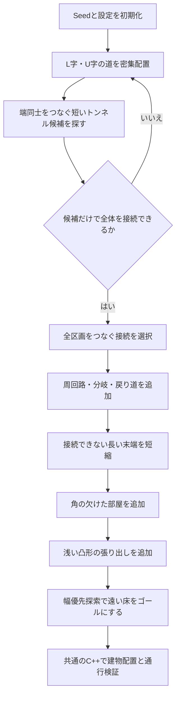

# Courtyardの密集迷路：実装とBlueprint版の解説

## 使うアセット

| 役割 | 場所 |
|---|---|
| プレイするマップ | `/Game/Map/InGame/Stage2/LVL_BackAlley_AutoCreateMap` |
| 今回作成したBP版 | `/Game/AutoCreateMap/Courtyard/AutoMapData/Blueprints/BP_Courtyard_Generator_BP` |
| 残してあるC++版のBP | `/Game/AutoCreateMap/Courtyard/AutoMapData/Blueprints/BP_Courtyard_Generator` |
| 配置する建物のデータ | `/Game/AutoCreateMap/Courtyard/AutoMapData/Data/DA_Courtyard_Theme` |

マップ上のジェネレーターをBP版へ切り替えた。PlayするとBPの `Event BeginPlay → GenerateCourtyardBP` が実行される。再生成も **GenerateCourtyardBP** を呼ぶ。継承している **GenerateCourtyard** は従来のC++版なので、BP版の再生成には使わない。

継承元の `Generate On Begin Play` はfalseにしてある。親のC++自動生成とBPのBeginPlayが同時に走らないための設定であり、BP版ではEventGraphから生成を開始する。

## 最初に理解すること

この迷路は、建物を一つずつランダムに置いているのではない。先に「歩ける床と接続」の設計図を整数のマスで完成させ、それを建物モデルへ置き換えている。

1マスは現在320 cm。基本の道幅は2マス。壁や建物は床が存在しない方向の境界へ配置する。このため床の形を変えるだけで、道の曲がり方や壁の輪郭も変わる。

`Node` は迷路を組み立てる曲がった道の区画であり、屋内の部屋そのものではない。屋内の部屋は別データの `RoomArea`。

## 生成の全体像

## BPを読む順番

BPエディター左側のFunctionsを、`Courtyard BP` のカテゴリ順に読む。まず **01 Entry → BuildCourtyardBP** を開くと、全体の呼び出し順が分かる。各関数の入口に日本語コメントを付けてある。

### 01 Entry：入口

- **GenerateCourtyardBP**：Seedが負なら抽選する。BPでPlanを作り、成功したら `RenderCourtyardPlan` に渡す。
- **BuildCourtyardBP**：設計図作成の全体手順。結果は `ResultPlan`、成功状態は `bBPBuildSucceeded`、失敗理由は `BPBuildError`。

このBPはC++の **BuildCourtyardPlanを呼んでいない**。道・接続・部屋・張り出し・ゴールの生成は、編集できるBPノードで実装している。

### 02 Dense streets：密集した道の骨格

**InitializeLayout** は設定を安全な範囲へ収め、配置列数、乱数、部屋候補などを準備する。

密集配置では `Span = StreetWidth + 2`。道幅2ならSpanは4、配置枠の一辺は `Extent = Span + StreetWidth = 6` マス。道幅を細くするのではなく、曲がり角間の距離を短くして空白を詰める。

**ChooseSectionCounts** は区画数を決める。密集時は2～3区画。**BuildBentNode** は長方形を端の角で重ね、L字・U字を作って0/90/180/270度に回転する。十字に重ねる配置はしない。

`Dense Packing` がfalseのときは従来の寸法と最大4区画の形を使用する。

### 03 Connections and loops：孤立防止と迷路の選択肢

**FindTunnelCandidates** は隣接する区画の端を探す。両端の間が空いていて、短い直線トンネルを通せる位置だけを候補にする。同じ区画同士でも十分離れた候補を最大2本残す。

**CandidateGraphReady** は候補全体を幅優先探索し、全区画へ到達できるか確認する。各区画の接続候補2本以上、分岐区画4個以上、独立した周回路3本以上も要求する。向きの抽選は最大33回で打ち切り、最後は接続できる基本の向きを使う。

**ConnectAllSpaces** は次の順序で接続を選ぶ。

1. 候補をシャッフルする。
2. まだ別々のグループに属する区画同士を接続する。`FindRoot` と `Parent` を使った全域木で、まず全体のつながりを保証する。
3. 残りの候補を `ExtraConnectionChance` で追加する。木に追加した接続が周回路になる。
4. 接続が1本しかない区画や、分岐・周回の不足を補う。

`Degrees` は各区画の接続数。3本以上ある区画が分岐。独立した周回路数は、全体が接続済みなら **接続数 − 区画数 + 1**。

そのため `ExtraConnectionChance = 0` にしても、保証に必要な周回路は残る。

### 04 Remove dead ends：長い行き止まりを残さない

「区画に出口が2本ある」だけでは、片側に長い袋小路が残る場合がある。

**EnsureFreeEndConnections** は、区画の自由な端に接続候補があるなら出口を採用する。候補が存在しない外周側の腕は、**TrimBlindEnds** が短くする。複数の曲がり角にまたがる末端も戻し、最後は曲がり角から最大1マスの出っ張りまで短縮する。

**RebuildFloorCells** は、この確定した形から床のセル表を作る。トンネルが床と重なった場合は失敗させる。

### 05 Rooms and bulges：部屋と凸形の変化

**AddRooms → TryRoom** は曲がり角の周辺で4×4マスの候補を探す。すでにある道を削らず、空いている角を1～2マス欠いて、14～15マスの歪な部屋にする。外の道と接する境界には出口を記録する。部屋を先に置き、張り出しが置き場を使い切らないようにしている。

**AddBulges → TryBulge** は奥行き1マス・長さ2～3マスの浅い凸形を、1区画に最大2か所追加する。試行は40回まで。

両方で使う **CanAddDetail** は次を確認する。

- 元の道の骨格から2歩以内。
- 配置枠の内側。
- 別区画やトンネルに勝手に触れない。
- 張り出しの場合は、向かいの道との間を埋めて曲がり道を潰さない。

形を変更するときは `TryRoom` / `TryBulge` を開く。部屋は矩形のSizeだけを変えず、候補セルを作るループ・角を欠く位置・扉の記録を合わせて調整する。

### 06 Utility：データとゴール

**GetStep / InSection / SectionAxis / Along / AtSectionEnd** は座標と区画の判定。方向は0東・1北・2西・3南。

**UpdateNodeBounds** は実床から外接矩形を計算する。外接矩形内のすべてが床になるわけではない。

**FinalizePlan** は床を座標順に並べ、開始点から幅優先探索を行う。到達距離が最大の屋外セルをゴールにし、共通の `ValidateCourtyardPlan` に渡す。単純な直線距離が最大の場所ではない。

## 主なデータ

| データ | 意味 |
|---|---|
| Settings | 道幅、区画数、接続確率、部屋数など |
| Node.Sections | L字・U字を構成する長方形 |
| Node.FloorCells | その区画の実際の床 |
| Node.DetailCells | 拡幅・張り出しで追加した床 |
| Link.Cells | 区画間の直線トンネル |
| RoomArea.FloorCells | 部屋の実際の輪郭。Min/Sizeは外接矩形 |
| RoomArea.DoorCells / DoorDirections | 部屋の扉のセルと外向き方向 |
| WorkCells | 整数座標から床情報を探すMap |
| Selected / Degrees / Parent | 接続の採用結果・接続数・連結グループ |
| ResultPlan | 描画へ渡す完成した設計図 |

セルの種類は `Street=0 / Tunnel=1 / Room=2`。BP内のByte比較もこの値を使う。

データ型はC++で定義済みのBlueprintType構造体を共有している。BP側でもMake / Break / Set Membersで編集できる。型を別に複製しないため、同じPlanをC++の配置・検証へ直接渡せる。

## C++とBPの担当範囲

| 処理 | 今回のBP版 |
|---|---|
| 配置寸法・乱数・道の形 | BP |
| 接続候補・全域木・周回路 | BP |
| 末端の短縮 | BP |
| 部屋・張り出し・扉情報 | BP |
| ゴールの選択 | BP |
| データ型の定義 | 共通C++ |
| Planの整合性検証 | 共通C++ |
| 建物レベル・床・壁の描画 | 共通C++ |
| プレイヤー寸法による実通行検証 | 共通C++ |

C++版の生成本体は `Source/Escape_on_Step_Demo/Generation/Courtyard/Layout/CourtyardLayout.cpp`、共通描画は `CourtyardGenerator.cpp`。今回の `CourtyardBlueprintEditor.cpp` はBPグラフを作成するエディター専用の補助処理であり、実行中の迷路生成には使わない。ゲームの実行にPythonも必要ない。

## 調整する場所

| 変えたい内容 | 設定・関数 |
|---|---|
| 全体の区画数 | Settings.StreetCount（9～24、最後の列は格子を埋める） |
| 密集配置の切替 | Settings.Dense Packing |
| 道幅 | Settings.StreetWidth（2～3） |
| 周回の追加頻度 | Settings.ExtraConnectionChance |
| トンネルの長さ | Settings.MinTunnelCells / MaxTunnelCells |
| 部屋の追加頻度・上限 | Settings.RoomChance / MaxRooms |
| 部屋の形 | TryRoom |
| 凸形の長さ・試行数・上限 | TryBulge / AddBulges |
| ゴールの選び方 | FinalizePlan |

細かく調整するときはSeedを固定する。設定変更の影響を同じ迷路で比較できる。Seedを負にすると毎回抽選する。

## 人へ説明する例

「先に整数のマスで歩ける道の設計図を作ります。小さなL字・U字を詰めて置き、端同士を短いトンネルでつなぎます。まず全体がつながる接続を選び、その後に分岐と戻り道を増やします。出口のない長い腕は短くし、ところどころに角の欠けた部屋や浅い張り出しを加えます。最後に開始点から遠い床をゴールにして、実際の建物を配置し、プレイヤーが全体を歩けるか確認します。」

最初はこの全体像を説明し、次に `BuildCourtyardBP`、`ConnectAllSpaces`、`TryRoom` の順でノードを見せると追いやすい。

## 検証記録

2026-11-16：BPコンパイルのエラー・警告0。244条件（固定Seed4種類と、道幅・接続確率・密集切替などを変えた240条件）でC++版と床・区画・接続・部屋・ゴールのデータ一致を確認した。

実マップの通行・再生成結果は `Saved/CourtyardBP/regen_result.json`、一致検証は `matrix_result.json`。変更前のマップと元BPは `Saved/CodexBackups/20261116_CourtyardBP/Before`。

実マップのSeed 0 / 1 / 37 / 28976で287 / 316 / 328 / 317セルすべてへの通行を確認。各ゴール1個、部屋3個。再生成時に以前の建物レベルが残らないことも確認した。対象マップと新規BPを除くContent内1887ファイルのハッシュに変化なし。元のC++版BP、LVL_BackAlley、建物レベル、マテリアルもこの確認に含む。
